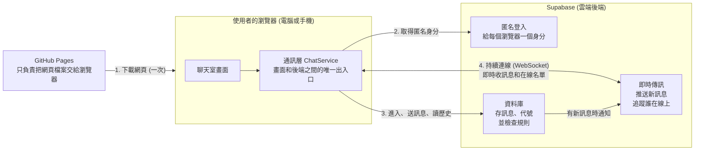

# 匿名聊天室 架構文件

這份文件寫給「不寫程式、但要決定做什麼和驗收」的人看。專有名詞第一次出現時會用一句話解釋。文件裡沒有程式碼,只有決定和理由。

---

## 1. 專案說明與目標

**這是什麼**:一個不用註冊、不用登入的匿名聊天室。所有人都在同一個聊天室裡,只要知道網址,用電腦或手機都能進來。

**使用者會做的事**:
1. 打開網頁
2. 輸入一個代號(1 到 12 個字)
3. 進入聊天室,看到最近 50 則訊息,看到誰在線上,也可以送出訊息
4. 想離開或換代號時,按「離開」回到輸入代號的畫面

**已經和你確認過的行為**:

| 項目 | 決定 |
|---|---|
| 代號 | 1 到 12 個字,中英文數字都可以,前後空白自動去掉,不能全是空白。大小寫視為相同。代號中間連續的空白合併成一個,各種長得像空白的字元一律當作一般空白。「系統」不能當代號 |
| 代號重複 | 擋下來,提示「這個代號已有人使用,請換一個」 |
| 歷史訊息 | 進入後先看到最近 50 則,再繼續收新訊息 |
| 重新整理、斷線 | 重新整理後用上次的代號自動回到聊天室。斷線後網路恢復會自動重連。短暫斷線不會跳出「離開、進入」提示 |
| 訊息 | 只能是純文字,上限 500 字,空白訊息送不出去,可以換行,連結只顯示成文字 |
| 送出方式 | 電腦按 Enter 送出、Shift+Enter 換行。手機的 Enter 是換行,要按送出按鈕 |
| 限速 | 3 秒內最多 5 則,超過時提示「送太快了,請稍等」 |
| 訊息版面 | 自己的訊息靠右、別人的靠左,每則顯示代號和時間。進入、離開的提示用置中的小字 |
| 線上名單 | 電腦版固定在側邊。手機版頂部顯示「N 人在線」,點開才展開名單 |
| 往上捲動時有新訊息 | 畫面不動,底部出現「有新訊息」按鈕,點了才跳到最底。本來就在最底時,畫面自動跟著捲動 |
| 分頁在背景 | 分頁標題顯示未讀數,例如「(3) 匿名聊天室」,回到分頁後清掉 |
| 離開 | 頂部有「離開」按鈕,按下後代號立刻釋放,其他人看到「某某離開了」 |

**做事的順序**(你指定的):先把前端做好並放上 GitHub Pages,最後才接上 Supabase。

---

## 2. 整體架構圖

先認識三個角色:

- **瀏覽器**:使用者開網頁的地方(電腦或手機)。
- **GitHub Pages**:GitHub 提供的免費網頁放置服務,只能放「固定不變的網頁檔案」,不能執行會變動的程式。
- **Supabase**:一個雲端後端服務,提供資料庫、帳號和即時傳訊功能。聊天室所有「會變動的東西」(訊息、誰在線上)都在這裡。



**怎麼讀這張圖**:
- 網頁是從 GitHub Pages 下載的,下載完之後,聊天的所有往來都和 GitHub Pages 無關,直接在瀏覽器和 Supabase 之間進行。
- 第 4 條線用 **WebSocket**(一種讓瀏覽器和伺服器保持持續連線的技術,伺服器有新東西可以立刻推給你,不用你一直問)。你的聊天室能「即時」就是靠它。
- 這個專案**沒有自己架伺服器**。規則(代號不重複、字數限制、限速)都由 Supabase 的資料庫來把關。

---

## 3. 技術選擇

每一項都寫「選了什麼」和「為什麼」。

### 3.1 前端

**前端**指使用者在瀏覽器裡看到、點到的那一部分。

| 項目 | 選了什麼 | 為什麼 |
|---|---|---|
| 語言 | **TypeScript**(JavaScript 的加強版,會在寫錯資料格式時提早提醒) | 瀏覽器只看得懂 JavaScript。聊天室裡的資料(訊息、代號、錯誤種類)會在前端和資料庫之間傳來傳去,格式一旦對不上就會出怪問題,TypeScript 能在開發時就抓到 |
| 框架 | **React**(最常見的網頁畫面框架,框架就是一套現成的蓋畫面工具) | 聊天室有很多會即時變動的部分:訊息列表、線上名單、未讀數、「有新訊息」按鈕。React 讓「資料變了,畫面自動跟著變」,不用手動一個一個去改 |
| 建置工具 | **Vite**(把你寫的程式整理、壓縮成可以放上網站的檔案的工具) | 輸出就是一包純靜態檔案,正好是 GitHub Pages 能放的東西 |
| 不選的 | Next.js 等需要伺服器的框架 | GitHub Pages 沒有伺服器可以跑它們 |

整個網站只有兩個畫面,用一個變數切換就好,不需要做多頁網址。這也避開 GitHub Pages 對「重新整理後找不到網址」處理很差的問題。

### 3.2 Supabase 用到的功能

| 要解決的事 | 用的功能 | 為什麼 |
|---|---|---|
| 不用登入,但要認得「同一個瀏覽器」 | **匿名登入**(Supabase 會自動給每個瀏覽器一個獨立的編號,使用者完全看不到登入畫面) | 沒有編號就沒辦法判斷「這個代號是誰的」、「誰在洗版」。有了編號,才能做到「重新整理後還是你的代號」和「別人不能冒充你」 |
| 保存訊息、載入最近 50 則 | **資料庫**(Supabase 用的是 Postgres,一種常見的資料庫)裡的訊息表 | 新進來的人要看得到歷史,所以訊息一定要存起來。只做即時廣播的話,沒在線上的人就永遠收不到 |
| 即時收到新訊息 | **Realtime 的資料庫變動通知**(資料表一新增一筆,就自動推給所有正在看的人) | 送訊息只要「寫進資料庫」這一個動作,不會出現「廣播出去了但沒存到」的不一致 |
| 誰在線上、進入和離開提示 | **Presence**(Realtime 的在線狀態追蹤,每個人連上就登記、斷線就自動消失) | 這個功能本來就是為「誰在線上」設計的,不用自己做偵測 |
| 代號不重複 | 一張專門記錄「代號屬於誰」的**成員表**,加上資料庫的唯一性檢查 | Presence 沒辦法保證先搶先贏:兩個人同一瞬間輸入同一個代號可能都成功。資料庫的唯一性檢查可以保證只有一個人成功 |
| 字數限制、限速、代號檢查 | **資料庫函式**(把「送訊息」這個動作做成資料庫內的一段固定流程,瀏覽器只能照流程呼叫) | 規則寫在資料庫才擋得住。如果只寫在前端,有人用別的工具直接呼叫 Supabase 就能繞過去 |
| 防止別人亂改資料 | **Row Level Security(RLS,資料列層級權限)**:資料庫的權限設定,規定誰能看哪些資料、能不能改 | 瀏覽器不能直接新增、修改、刪除任何東西,只能呼叫上面的資料庫函式 |
| 定期清舊訊息 | **pg_cron**(資料庫內建的排程功能) | 畫面只顯示最近 50 則,太舊的資料沒用,留著只會越積越多。預設每天刪除超過 7 天的訊息 |

### 3.3 代號怎麼保證不重複(詳細說明)

**這一節是階段二的做法。** 階段一的假通訊層沒有心跳,也沒有 3 分鐘保留,只是拿輸入的代號去比對機器人的名單。

- **進入**:瀏覽器呼叫「登記代號」。資料庫先清掉「超過 3 分鐘沒有任何動靜」的舊登記,再嘗試登記。同一瞬間搶同一個代號,只有一個人成功,另一個會收到「代號已被使用」。
- **同一個人重新整理**:匿名編號相同,資料庫認得是同一個人,代號仍然是他的。
- **保持佔用**:聊天室開著的時候,每 30 秒自動向資料庫報一次到(這叫**心跳**,像定時回報「我還在」)。
- **主動離開**:按「離開」,代號立刻釋放。
- **直接關掉分頁**:3 分鐘後沒有心跳,代號自動釋放。
- **回來時代號已被別人拿走**:自動回到輸入代號畫面,並提示「你的代號已被別人使用,請重新輸入」。

---

## 4. 兩個階段

### 階段一:還沒接 Supabase

**這個階段做出什麼**:整個前端,而且所有畫面和互動都看得到、點得到,只是資料是假的。

| 能做到 | 怎麼做到 |
|---|---|
| 兩個畫面(輸入代號、聊天室)電腦版和手機版 | 用 `/design` 和 `/frontend-design` 做 |
| 輸入代號、進入聊天室 | 假通訊層接受任何合格的代號 |
| 看到最近 50 則歷史訊息 | 假通訊層預先放了一批假訊息 |
| 看到線上名單、有人進來和離開的提示 | 假通訊層裡有幾個「機器人」,會隨機進來、離開、說話 |
| 送出訊息、自己的靠右別人的靠左 | 送出後假通訊層直接把訊息加進列表 |
| 代號重複的錯誤提示 | 機器人的代號都算「已被使用」,輸入同樣的代號就會看到錯誤 |
| 送太快的提示 | 假通訊層也套用 3 秒 5 則的規則 |
| 「有新訊息」按鈕、分頁標題未讀數 | 純畫面行為,不需要後端,機器人說話就能觸發 |
| 重新整理後自動回到聊天室 | 代號存在瀏覽器裡 |
| 斷線和重連的畫面 | 提供一個隱藏的展示開關:網址後面加 `?demo=1`,畫面左上角會出現「展示開關」,有 4 個按鈕:模擬斷線、恢復連線、代號被別人拿走、讓機器人說一句。斷線期間機器人說的話,恢復連線後會補回來 |
| 離開 | 回到輸入代號畫面 |

**階段一的限制**:每個訪客只會看到自己和機器人,**看不到其他真人**。所以放上 GitHub Pages 的階段一版本是「展示用」,不是真的能多人聊天。

**怎麼在 GitHub Pages 上看到**:把前端推上 GitHub,GitHub 會自動建置並發佈,你會得到一個網址,在手機和電腦上打開就能操作(發佈方式見第 12 節)。

### 階段二:接上 Supabase 之後的改變

| 項目 | 階段一 | 階段二 |
|---|---|---|
| 訊息和線上名單 | 假的、在記憶體裡 | 真的,存在 Supabase |
| 其他人 | 機器人 | 真人 |
| 代號重複判斷 | 比對機器人名單 | 資料庫判斷 |
| 限速 | 前端自己算 | 資料庫判斷(前端仍然保留提示) |
| 關掉分頁後 | 沒有影響 | 代號 3 分鐘後釋放 |
| 機器人和展示開關 | 有 | 移除 |
| 需要金鑰 | 不需要 | 需要(見第 8 節) |

### 為什麼階段二不用重寫前端

關鍵設計:畫面**不直接**和後端說話,中間隔一層「**通訊層**」(在文件裡叫 `ChatService`)。可以把它想成牆上的插座:畫面只管把插頭插進插座,不管牆後面接的是假電源還是真電源。

通訊層提供畫面需要的固定幾個動作和事件(詳見第 5 節)。階段一做一個「假的通訊層」,階段二做一個「Supabase 的通訊層」。兩個長得一樣、能互相替換,**畫面的程式完全不用動**,只要換掉接上去的那一個。

這也要求階段一就要把畫面和通訊層的邊界守住:畫面裡不可以出現「我知道資料來自哪裡」的寫法。

---

## 5. 通訊約定

畫面和通訊層之間約定好的「語言」。階段一的假通訊層和階段二的真通訊層都必須遵守同一份約定。

### 5.1 畫面可以要求通訊層做的動作

| 動作 | 說明 | 可能的失敗原因 |
|---|---|---|
| `join(代號)` | 登記代號、進入聊天室 | 代號格式錯、代號已被使用 |
| `leave()` | 離開,釋放代號 | 無 |
| `sendMessage(內容)` | 送出一則訊息 | 內容空白或太長、送太快、你已經不是成員 |
| `loadRecent(50)` | 取得最近 50 則歷史訊息 | 連線失敗 |
| `loadSince(訊息編號)` | 斷線重連後補抓漏掉的訊息 | 連線失敗 |

### 5.2 通訊層會通知畫面的事件

| 事件名稱 | 什麼時候發生 | 帶什麼資料 |
|---|---|---|
| `message` | 有新訊息(包含自己送的) | 一則訊息(格式見 5.3) |
| `members` | 線上名單變了 | 目前在線的代號清單 |
| `notice` | 有人進入或離開(已經過寬限時間判斷) | 提示編號(`id`,畫面用來區分每一則提示)、種類(`join` 或 `leave`)、代號 |
| `connection` | 連線狀態變了 | `connected`(連線中)、`reconnecting`(重連中)、`kicked`(代號已被別人拿走,要重新輸入) |

### 5.2.1 通訊層上的其他項目

- `selfId`:這個瀏覽器的匿名編號,畫面用它判斷哪些訊息是自己的。
- `demo`:展示開關用的控制,**只有階段一的假通訊層有**,階段二的真通訊層沒有這一項,連同展示開關一起移除。

### 5.3 訊息的資料格式

| 欄位 | 意思 | 範例 |
|---|---|---|
| `id` | 訊息編號,由資料庫給,越新越大,用來排順序和補漏 | 1042 |
| `nickname` | 發話者的代號,由資料庫填入,**不是前端傳的** | 小明 |
| `body` | 內容(純文字,1 到 500 字,可含換行) | 大家好 |
| `createdAt` | 送出時間(由資料庫記錄,不是用使用者手機的時間),格式是 ISO 時間字串,畫面只顯示成「14:05」 | 2026-10-13T14:05:32+08:00 |
| `senderId` | 發話者的匿名編號,前端用來判斷「這是不是我的訊息」(靠右還是靠左) | (一串隨機編號) |

### 5.4 錯誤種類

畫面不顯示技術訊息,只依照下面的代碼轉成使用者看得懂的中文:

| 代碼 | 畫面上顯示 |
|---|---|
| `nickname_taken` | 這個代號已有人使用,請換一個 |
| `nickname_invalid` | 代號要 1 到 12 個字,不能全是空白,也不能用「系統」 |
| `rate_limited` | 送太快了,請稍等 |
| `body_invalid` | 訊息不能是空白,最多 500 字 |
| `not_member` | 回到輸入代號畫面,顯示「你的代號已被別人使用,請重新輸入」(和代號被拿走走同一條路) |
| `network` | 進入時失敗:「連線失敗,請檢查網路後再試一次」。送訊息時失敗:「送出失敗,網路不穩,請再試一次」。連線中斷期間,頂部另外顯示「連線中…」 |

---

## 6. 資料流

下面用白話描述各個情況下發生的事。

**這一節描述的是階段二接上 Supabase 之後的完整流程。** 階段一的假通訊層沒有下面這幾項,標了「(階段二)」:主動離開時的「bye」通知、15 秒寬限時間、心跳和 3 分鐘保留代號、手機切回前景時主動重連。階段一的重連只做「補抓斷線期間漏掉的訊息」。

### 6.1 進入聊天室

1. 使用者打開網頁,畫面先檢查瀏覽器裡有沒有上次存的代號。
   - 有:跳到第 6 步,自動嘗試進入。
   - 沒有:顯示輸入代號畫面。
2. 使用者輸入代號,按進入。前端先檢查格式(去掉前後空白、1 到 12 個字),不合格就當場提示。
3. 通訊層向 Supabase 取得匿名身分(第一次來才會建立,之後會記住)。
4. 通訊層向資料庫登記代號。
5. 登記成功就把代號存進瀏覽器;失敗(`nickname_taken`)就留在輸入畫面顯示提示。
6. 進入聊天室畫面。通訊層取得最近 50 則訊息,同時開始接收新訊息,並在線上名單登記自己。
7. 其他人看到「某某進來了」。畫面顯示「載入中」直到歷史訊息載完。

### 6.2 送出訊息

1. 使用者打字,按 Enter(電腦)或送出按鈕。
2. 前端先檢查:空白不送;超過 500 字不送;距離上次送出太快則暫停輸入框並提示。
3. 通訊層把內容交給資料庫。資料庫再檢查一次(是不是成員、字數、有沒有送太快),並**由資料庫自己決定代號和時間**,存進訊息表。
4. 資料庫通知所有正在線上的人有新訊息。**自己送的也是這樣收到的**,這樣所有人看到的順序一致。
5. 每個人的畫面收到 `message` 事件:自己的靠右、別人的靠左。
   - 正在看最底:自動捲到最底。
   - 往上捲動中:畫面不動,出現「有新訊息」按鈕。
   - 分頁在背景:標題未讀數加 1。
6. 如果送出失敗(送太快、網路斷),輸入的文字**要保留**在輸入框,不能消失,並提示原因。

### 6.3 離開

1. 使用者按「離開」。
2. (階段二)通訊層先發一個「我主動離開了」的通知給其他人(讓他們跳過等待時間,立刻顯示離開),然後告訴資料庫釋放代號,並從在線名單移除。
3. 瀏覽器裡存的代號被清掉,畫面回到輸入代號。
4. 其他人看到「某某離開了」,線上名單少一個人,這個代號可以給別人用。

### 6.4 斷線與重連

**情況 A:短暫斷線(重新整理、手機網路閃一下)(階段二)**
1. 其他人的畫面發現這個人不見了,但**先不顯示離開**,等 15 秒(叫「寬限時間」)。
2. 15 秒內他以同一個代號回來,就當作沒離開,不顯示任何提示,線上名單也沒有變化。

**情況 B:自己這邊斷線**
1. 畫面頂部顯示「連線中…」,輸入框暫時不能送。
2. 網路恢復後自動重連,依序做:重新登記在線、向資料庫報到(保住代號)、補抓斷線期間漏掉的訊息(用「最後收到的訊息編號」往後抓)。
3. 頂部提示消失,恢復正常。

**情況 C:手機切到別的 app 再回來(階段二)**
手機瀏覽器常常會在背景中斷連線。頁面回到前景時,前端主動執行一次情況 B 的重連流程。

**情況 D:斷線太久,代號被別人拿走了**
重連時登記代號失敗,畫面回到輸入代號畫面,提示「你的代號已被別人使用,請重新輸入」。

**情況 E:關掉分頁沒按離開(階段二)**
其他人在 15 秒寬限後看到「某某離開了」。代號會再保留到滿 3 分鐘沒心跳才釋放。(所以 15 秒到 3 分鐘之間,他不在名單上,但別人也還不能用他的代號。)

---

## 7. 畫面清單

只列出「有什麼、做什麼」,顏色、字型、間距由 `/design` 決定。

### 畫面一:輸入代號

| 元素 | 行為 |
|---|---|
| 標題、一句簡短說明 | 純文字 |
| 代號輸入框 | 打字時即時檢查長度;自動去掉前後空白;按 Enter 等同按進入 |
| 進入按鈕 | 代號不合格時不能按;按下後到成功之前顯示處理中,避免連按 |
| 錯誤提示區 | 顯示「代號已有人使用」「代號要 1 到 12 個字」「你的代號已被別人使用,請重新輸入」等 |

### 畫面二:聊天室

**(a) 頂部列**
| 元素 | 行為 |
|---|---|
| 聊天室名稱 | 純文字 |
| 在線人數 | 手機版:顯示「N 人在線」,點一下展開名單,再點收起。電腦版:顯示在側邊名單的標題。剛進入、名單還沒收到時,人數顯示「—」 |
| 離開按鈕 | 按下立刻離開,回到畫面一 |
| 連線狀態提示 | 連線中斷時顯示「連線中…」,恢復後消失 |

**(b) 線上名單**
| 元素 | 行為 |
|---|---|
| 名單 | 列出所有在線代號,自己那一個要有標示(例如標上「你」) |
| 電腦版 | 固定在側邊 |
| 手機版 | 點頂部人數才展開,不佔聊天畫面的位置。展開後,再點人數鈕、點名單外的暗色背景,或按 Esc,都可以收起 |

**(c) 訊息列表**
| 元素 | 行為 |
|---|---|
| 一般訊息 | 自己的靠右、別人的靠左;每則顯示代號和時間;換行要保留;網址顯示成純文字,不能點 |
| 系統提示 | 「某某進來了」「某某離開了」,置中小字,和一般訊息看起來不同 |
| 載入中 | 剛進入、歷史訊息還沒載完時顯示 |
| 空狀態 | 歷史是空的時顯示「還沒有人說話」之類的提示 |
| 「有新訊息」按鈕 | 往上捲動時有新訊息才出現,在底部;點了跳到最底並消失;自己捲回最底時也消失 |
| 捲動規則 | 在最底:新訊息進來自動跟著捲。不在最底:畫面不動 |

**(d) 輸入區**
| 元素 | 行為 |
|---|---|
| 輸入框 | 可多行。電腦:Enter 送出、Shift+Enter 換行。手機:Enter 換行。程式是用「是不是觸控裝置」來判斷電腦或手機,不是看螢幕寬度,所以觸控螢幕的筆電會被當成手機。用中文輸入法選字時按 Enter,不會被當成送出 |
| 送出按鈕 | 內容空白時不能按;送出後輸入框清空,游標留在裡面 |
| 字數提示 | 剩 50 字以內時顯示「還可輸入 N 字」;超過 500 字顯示「超過 N 字,無法送出」,不能送 |
| 限速提示 | 觸發限速時輸入框暫時停用,顯示「送太快了,請稍等」,幾秒後自動恢復 |
| 送出失敗 | 文字保留在輸入框,顯示原因 |

**(e) 分頁標題**
| 行為 |
|---|
| 分頁在背景、有別人的新訊息:顯示「(未讀數) 匿名聊天室」。回到分頁後清掉 |

**手機版的額外要求**:輸入框的字體不能太小(手機瀏覽器對太小的輸入框會自動放大畫面);鍵盤彈出來時,輸入框和最新訊息要保持看得到。

---

## 8. 金鑰

**金鑰**是程式向 Supabase 證明「我有權限」的一串長字串。這個專案會碰到的有下面幾種:

| 名稱 | 用途 | 能不能公開 |
|---|---|---|
| **專案網址**(Project URL) | Supabase 專案的位址 | 可以。它本來就會出現在網頁的網路請求裡 |
| **Publishable key**(公開金鑰,舊名 anon key) | 讓網頁以「一般使用者」身分呼叫 Supabase,受第 3 節的權限規則限制 | **可以公開**。它一定會被包進前端程式,任何人用瀏覽器的開發者工具都看得到,不可能藏 |
| **Secret key**(祕密金鑰,舊名 service_role key) | 繞過所有權限規則,等於資料庫的管理員 | **絕對不能公開**。不能放進前端、不能 commit、不能貼在任何聊天或截圖。這個專案**用不到它** |
| **資料庫密碼** | 直接連資料庫用 | **絕對不能公開**。這個專案用不到,除非之後要用外部工具直接連線 |

### 怎麼產生

建立 Supabase 專案後,到專案的設定頁面的 API 區,複製**專案網址**和 **Publishable key**。就這兩個。**不要複製 Secret key**,既然用不到,就不要讓它離開 Supabase 的後台。

### 放在哪裡

- **你的電腦上開發時**:放在專案根目錄的 `.env.local` 檔案(環境變數檔,專門放「會因環境不同而改變的設定」)。裡面兩行:專案網址、Publishable key。
- **GitHub 上自動發佈時**:放在 GitHub repo 的設定頁面,Settings 裡 Actions 的 variables 區,由發佈流程在建置時帶進去。

### 為什麼 Publishable key 可以公開

安全不是靠「藏金鑰」,而是靠**資料庫端的把關**:瀏覽器不能直接新增、修改、刪除任何資料,只能呼叫幾個固定流程(登記代號、送訊息、離開),這些流程自己會檢查規則。就算有人拿到 Publishable key,他能做的事也只有這幾件。

### 怎麼避免金鑰被 commit 到 GitHub

1. `.gitignore`(告訴 Git「這些檔案不要追蹤」的清單)要包含 `.env`、`.env.local` 等所有 `.env*` 檔案,**在建立第一個 `.env.local` 之前就要先加好**。
2. repo 裡放一個 `.env.example`,只有欄位名稱,值是空的或寫「請填入」,讓別人知道要設定什麼。
3. 開啟 GitHub 的 **Secret scanning 和 Push protection**(GitHub 會掃描,發現像金鑰的字串就阻止推送)。
4. commit 之前看一下變更清單,確認沒有 `.env*` 檔案。
5. **萬一 Secret key 或資料庫密碼外洩**:立刻到 Supabase 後台重新產生(舊的立刻失效),不要只是從 GitHub 刪掉檔案,因為 Git 歷史還留著。

---

## 9. 安全與限制

### 9.1 別人可能送什麼奇怪的東西,怎麼擋

**原則**:前端的檢查是為了讓使用者馬上得到回饋;真正能擋住壞人的是資料庫的檢查,因為壞人可以繞過你的網頁,直接呼叫 Supabase。所以每一項都要「前端擋一次、資料庫再擋一次」。

| 奇怪的東西 | 會怎樣 | 前端怎麼做 | 資料庫怎麼做 |
|---|---|---|---|
| 訊息裡夾帶網頁程式碼(例如 `<script>`),想在別人畫面上執行 | 這是最嚴重的一種攻擊(**XSS**,在別人的瀏覽器裡執行惡意程式) | 所有訊息和代號**一律當純文字顯示**,不可以用任何「把文字當網頁解讀」的寫法 | 不處理(資料庫只存文字,擋在顯示端) |
| 超長訊息 | 把畫面撐爆、拖慢所有人 | 超過 500 字不能送;長字串(沒有空白的一長串)要能自動換行不撐版面 | 超過 500 字直接拒絕 |
| 超長或空白的代號 | 名單版面被破壞 | 1 到 12 個字;去掉前後空白 | 同樣規則 |
| 看起來像空白的代號(用特殊空白字元、不可見字元) | 名單上出現一個「看起來沒有名字」的人,或和別人的名字看起來一樣 | 輸入時拿掉不可見字元和控制字元;長得像空白的字元換成一般空白,連續空白合併成一個 | 同樣處理,並拒絕處理之後變空的代號 |
| 冒充系統或他人(代號叫「系統」,或只差大小寫) | 假的系統提示、冒充別人 | 擋掉「系統」等保留字 | 代號比對不分大小寫;保留字拒絕 |
| 字元把版面方向弄反(從右到左的控制字元) | 訊息和名單排版錯亂 | 輸入時拿掉這類控制字元 | 同樣處理 |
| 一大堆換行 | 一則訊息佔滿整個畫面 | 連續空行壓縮成最多一行 | 不處理 |
| 狂送訊息洗版 | 聊天室無法使用 | 3 秒 5 則,超過就暫停輸入框 | 同樣限速,超過直接拒絕,不看前端 |
| 假冒別人的身分送訊息 | 以別人的名字說話 | 無 | 代號由資料庫從成員表取得,**不接受前端傳來的代號** |
| 直接去改或刪別人的訊息 | 破壞聊天內容 | 無 | 瀏覽器沒有任何修改和刪除的權限 |
| 一個人開很多瀏覽器、清資料重來,繞過限速 | 洗版 | 無 | 第一版不處理(見 9.3),之後可以加驗證碼 |

### 9.2 免費方案要注意的上限

以下數字是 2026-10-13 對照 Supabase 官方文件確認的。免費方案的內容會調整,正式上線前請再看一次:

- **同時連線人數**:200 個。連結如果被大量轉傳,可能會滿。
- **每秒訊息數**:100 則。**Presence**(誰在線上)每秒 20 則。
- **資料庫大小**:每個專案 500 MB。這也是為什麼要定期清舊訊息。免費帳號最多 2 個專案。
- **閒置會暫停**:免費專案連續一週活動很低,會被暫停,暫停期間聊天室打不開。官方會先寄警告信,暫停後一年內可以在後台按 Resume project 恢復,資料不會消失。要避免的話,可以用定期呼叫資料庫的方式維持活動(是否做,階段二再決定)。
- **匿名登入的頻率限制**:同一個 IP(例如同一間學校、同一個公司)每小時 30 次,超過會登入失敗。可以在 Supabase 的設定裡調整。官方也建議對匿名登入開驗證碼(CAPTCHA),第一版先不開,見 9.3。
- **GitHub Pages**:公開的 repo 可以免費使用。網站大小和每月流量有上限,這個專案是很小的靜態網頁,不會碰到。

來源:Supabase 官方文件的 Realtime Limits、Anonymous Sign-Ins、Billing、Project Pausing 各頁。

### 9.3 這一版接受的風險

- 沒有驗證碼,有人寫程式大量建立匿名身分,可以繞過限速。遇到時再加。
- 沒有管理功能。出問題時你只能到 Supabase 後台直接處理資料。
- 使用者清掉瀏覽器資料,等於變成另一個人。舊代號會在 3 分鐘內自動釋放,最壞的情況是暫時不能用原本的代號。

---

## 10. 這一版刻意不做的事

| 不做 | 為什麼 |
|---|---|
| 註冊、登入 | 你的需求就是匿名,不用登入 |
| 圖片、檔案、連結預覽 | 要處理檔案上傳、儲存空間和內容審核,範圍會大很多。第一版只收純文字 |
| 表情符號按鈕 | 不是必要功能。手機鍵盤本來就能輸入表情符號,所以不影響使用 |
| 提示音 | 公開聊天室容易讓人覺得吵,也要處理各瀏覽器的播放限制。第一版只用分頁標題的未讀數 |
| 改名 | 先離開再用新代號進入就能達到同樣效果,不需要多做一個功能 |
| 檢舉、踢人、刪訊息 | 需要「管理員」這個身分,而你要的是不用登入。第一版靠限速擋洗版 |
| 多個聊天室、私訊 | 需求是「所有人在同一個聊天室」 |
| 訊息的編輯和刪除 | 增加權限判斷的複雜度,沒有明確需求 |
| 瀏覽器通知(桌面彈出提示) | 需要使用者授權,對匿名聊天室來說太打擾 |
| 永久保存所有歷史 | 資料會無上限成長,免費方案撐不住 |
| 保存進出提示 | 進出提示由各瀏覽器當下判斷,不存進資料庫。所以晚進來的人看不到更早的進出提示 |

---

## 11. repo 的資料夾結構

**repo** 是存放整個專案檔案的地方(GitHub 上的一個專案)。

```
chat/
├─ docs/
│   ├─ requirements.md          需求說明(你寫的)
│   ├─ architecture.md          這份文件
│   └─ design.md                畫面設計結果(顏色、尺寸、元件規格)
├─ src/                         前端程式碼
│   ├─ main.tsx、App.tsx        程式進入點;App 決定顯示哪個畫面
│   ├─ styles.css               全部的樣式和設計變數
│   ├─ services/                通訊層
│   │   ├─ ChatService.ts       約定:畫面可以要求什麼、會收到什麼
│   │   ├─ MockChatService.ts   階段一:假的通訊層
│   │   ├─ index.ts             唯一決定「用哪一個通訊層」的地方
│   │   └─ SupabaseChatService.ts   階段二才會新增:真的通訊層
│   ├─ components/              畫面零件
│   │   ├─ NicknameScreen.tsx   畫面一:輸入代號
│   │   ├─ ChatScreen.tsx       畫面二:聊天室(含頂部列、訊息列表、
│   │   │                       載入中和空狀態、有新訊息按鈕、手機版名單)
│   │   ├─ MessageItem.tsx      一則訊息或一則進出提示
│   │   ├─ MessageInput.tsx     輸入區(字數、限速、失敗提示)
│   │   ├─ OnlineList.tsx       線上名單
│   │   ├─ DemoPanel.tsx        展示開關(階段二移除)
│   │   └─ icons.tsx            圖示
│   ├─ hooks/                   可重複使用的行為
│   │   ├─ useChat.ts           整個聊天室的狀態和動作(含連線狀態、重連補訊息)
│   │   ├─ useAutoScroll.ts     自動捲動和「有新訊息」按鈕
│   │   └─ useUnreadTitle.ts    分頁標題的未讀數
│   └─ lib/                     小工具
│       ├─ text.ts              代號和訊息的檢查與清理
│       ├─ rateLimit.ts         限速計算
│       ├─ messages.ts          錯誤代碼轉成中文
│       └─ time.ts              時間顯示
├─ public/favicon.svg           分頁圖示
├─ index.html                   網頁的起點
├─ package.json                 專案用到哪些套件、有哪些指令
├─ package-lock.json            套件的確切版本(自動產生)
├─ vite.config.ts               建置設定(含 GitHub Pages 的網址路徑)
├─ tsconfig.json                TypeScript 設定
├─ supabase/
│   └─ migrations/              階段二才會新增:資料庫設定檔(資料表、規則、
│                               權限、排程),存成檔案才能重現
├─ .github/
│   └─ workflows/deploy.yml     自動發佈到 GitHub Pages 的設定
├─ .env.example                 環境變數範本(只有欄位名稱,沒有真實的值)
├─ .gitignore                   不要追蹤的檔案清單(包含 .env*)
├─ CLAUDE.md                    給 Claude 的專案說明
└─ README.md                    怎麼在自己電腦上跑起來
```

`supabase/` 資料夾和 `SupabaseChatService.ts` 到階段二才會出現。`.env.local`(放真實金鑰)只存在你的電腦上,不會出現在 repo 裡。

---

## 12. 部署到 GitHub Pages 的方式

**部署**就是把做好的網頁放到網路上讓大家打得開。

1. **repo 設成公開**(免費的 GitHub Pages 需要公開 repo,所以公開的檔案裡絕對不能有祕密,見第 8 節)。
2. 到 repo 的 Settings 的 Pages,發佈來源選「**GitHub Actions**」。(GitHub Actions 是 GitHub 內建的自動化工具,可以設定「每次有新程式推上來就自動做某些事」。)
3. 專案裡放一份自動發佈設定。每次你把更新推到 `main` 分支,它會自動:取得程式碼、建置(把程式整理成可上網的檔案)、把成品發佈到 GitHub Pages。
4. **網站路徑要設定**:專案網站的網址是「帳號.github.io/repo 名稱/」,不是直接在根目錄。建置工具要被告知這個路徑,否則網頁會找不到自己的樣式和程式,畫面會一片空白。設定在 `vite.config.ts`:正式建置和 `npm run preview`(預覽建置結果)都用 `/chat/`,這樣本機預覽看到的才和 GitHub Pages 上一樣;只有開發用的 `npm run dev` 是根目錄 `/`,網址是 `http://localhost:5173/`,預覽的網址是 `http://localhost:4173/chat/`。repo 改名時,這個路徑要一起改。
5. 階段二時,把專案網址和 Publishable key 放進 repo 的 Actions variables,讓自動發佈在建置時帶進去。
6. 發佈完成後,GitHub 會給你網址,用手機和電腦各打開一次確認。
7. 日後更新:推到 `main`,幾分鐘內網站就會自動更新,不需要手動上傳。

---

## 13. 驗證清單

### 階段一(前端 + 假通訊層,放在 GitHub Pages 上)

**發佈**
- [ ] GitHub Pages 網址打得開,不是空白頁
- [ ] 電腦和手機都能正常顯示

**輸入代號畫面**
- [ ] 空白、全空白、超過 12 個字,都不能進入並有提示
- [ ] 前後有空白的代號會被自動去掉
- [ ] 輸入機器人用的代號,看到「已有人使用」
- [ ] 按 Enter 等同按進入

**聊天室畫面**
- [ ] 進入後看到歷史訊息,載入中和空狀態都有顯示
- [ ] 機器人進來和離開,出現置中的系統提示,線上名單同步變化
- [ ] 自己的訊息靠右、別人的靠左,有代號和時間
- [ ] 電腦:Enter 送出、Shift+Enter 換行。手機:Enter 換行,按鈕送出
- [ ] 空白訊息送不出去;超過 500 字送不出去;接近上限有字數提示
- [ ] 連續快速送出,觸發「送太快了」提示,幾秒後恢復
- [ ] 往上捲動時機器人說話:畫面不動,出現「有新訊息」按鈕;點了跳到最底
- [ ] 停在最底時,新訊息自動跟著捲
- [ ] 切到別的分頁後機器人說話,標題出現未讀數;回來後清掉
- [ ] 手機版:頂部顯示「N 人在線」,點開展開名單,再點收起
- [ ] 手機版:鍵盤彈出時,輸入框和最新訊息仍看得到;輸入時畫面不會被自動放大
- [ ] 把送出文字裡放 `<script>` 之類的內容,畫面上原樣顯示成文字,不會被執行
- [ ] 一長串沒有空白的字,不會撐破版面
- [ ] 重新整理後自動回到聊天室
- [ ] 按「離開」回到輸入代號畫面,可以用新代號再進入
- [ ] 用展示開關切換成連線中斷,看到「連線中…」提示和輸入框的狀態

**通訊約定**
- [ ] 畫面程式裡沒有直接依賴假通訊層的寫法(之後換掉才不用改畫面)

### 階段二(接上 Supabase)

**基本功能**(用兩個不同的瀏覽器,或一個一般視窗加一個無痕視窗)
- [ ] A 進入,B 看到「A 進來了」,名單有 A
- [ ] A 送訊息,B 即時看到,順序和內容一致
- [ ] B 送訊息,A 即時看到
- [ ] 第三個人晚進來,看到最近 50 則,不是全部,也不是空的
- [ ] A 按離開,B 馬上看到「A 離開了」,名單少一人

**代號**
- [ ] B 輸入 A 正在用的代號,被擋下
- [ ] B 輸入 A 的代號但大小寫不同,也被擋下
- [ ] A 離開後,B 立刻可以用 A 的代號
- [ ] A 直接關掉分頁,約 3 分鐘後 B 才能用 A 的代號
- [ ] 兩個人同時搶同一個代號(盡量同時按),只有一個成功

**重新整理與斷線**
- [ ] A 重新整理,自動回到聊天室,代號不變,B 沒有看到「離開、進入」提示
- [ ] A 把網路關掉約 5 秒再打開,B 沒有看到離開提示,A 斷線期間漏掉的訊息會補回來
- [ ] A 斷網超過 15 秒再回來:B 會看到「A 離開了」再看到「A 進來了」,A 的代號仍然是 A 的
- [ ] A 斷網超過 3 分鐘,B 用了 A 的代號,A 恢復後回到輸入代號畫面並有提示
- [ ] 手機:切到別的 app 一分鐘再回來,自動重連並補抓訊息

**規則是不是真的由資料庫把關**
- [ ] 繞過網頁,用別的工具直接送超過 500 字,被拒絕
- [ ] 繞過網頁,連續快速送訊息,超過限速的被拒絕
- [ ] 繞過網頁,嘗試直接修改或刪除訊息,被拒絕
- [ ] 繞過網頁,送訊息時指定別人的代號,沒有效果(顯示的是自己的代號)

**金鑰與部署**
- [ ] `git status` 和 GitHub 上都找不到 `.env*` 檔案
- [ ] 在前端程式和網路請求裡找不到 Secret key 或資料庫密碼
- [ ] GitHub Pages 上的版本(不是本機)能正常聊天
- [ ] 手機的 4G 或 5G 網路(不是同一個 Wi-Fi)也能連上

**資料整理**
- [ ] 清舊訊息的排程已建立,測試時手動確認它只刪超過 7 天的訊息
